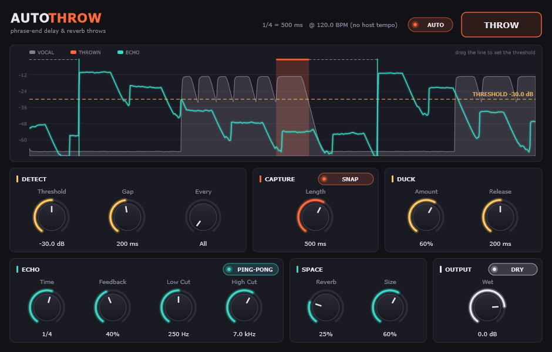

# Auto Throw

A vocal effect (VST3 + Standalone) for hip-hop and R&B mixing, built with C++ and
JUCE 9. It listens for the end of each vocal phrase and throws the **last word**
into a tempo-synced delay and reverb, so you get "...night, night, night" echoes
without drawing send automation. The dry vocal stays clean.



## How it works

```
vocal ─┬──────────────────────────────────────────────── dry ──┐
       │                                                        ├─▶ out
       ├─▶ phrase detector ─▶ capture last word ─▶ echo ─▶ verb ─▶ duck ─┘
       └─▶ input history ──────────▲                  (filters in the loop)
```

1. **Detect.** An envelope follower checks the vocal against the threshold. Once
   it has stayed quiet for the **Gap** time, the phrase is over.
2. **Capture.** The end of the phrase is pulled from a short input history. With
   **Snap** on, the capture starts at the last dip in level before the end (the
   last word or syllable), up to **Length** long.
3. **Throw.** The captured word is scheduled on the delay grid relative to when
   it was sung (word start + 1, 2, … beats). This keeps the echoes in time with
   no plugin latency, even though the phrase end is only known after the gap.
   If the first grid point has already passed, the echo comes in on the next one.
4. **Echo.** A feedback delay with high-pass and low-pass filters inside the
   loop, so each repeat gets thinner and darker. In ping-pong mode, each throw
   starts on the opposite side from the last one.
5. **Duck.** The echoes dip while the vocal is active and swell back in the gaps.

The **THROW** pad is a momentary send. Hold it (or automate it) to feed the echo
by hand, the same as riding an aux send. It works with **Auto** on or off.

## Controls

| Section | Control | What it does |
|---|---|---|
| Header | **Auto** | Throw automatically at phrase ends |
| | **THROW** | Hold to open the send manually. It's automatable, and it flashes when Auto fires |
| Detect | **Threshold** | Level that counts as vocal. You can also drag the yellow line in the display |
| | **Gap** | Silence needed before a phrase counts as finished |
| | **Every** | Throw every phrase, or 1 in N. Counts from the top of playback |
| Capture | **Length** | How much of the phrase end to throw (the maximum when Snap is on) |
| | **Snap** | Snap the capture to the last word or syllable |
| Duck | **Amount / Release** | How far the echoes dip under the vocal, and how fast they come back |
| Echo | **Time** | Echo spacing, 1/16 to 1 bar, synced to the host tempo |
| | **Feedback** | Number of repeats (up to 95%) |
| | **Low Cut / High Cut** | Filters on the repeats, applied again on every pass |
| | **Ping-Pong** | Bounce the repeats between left and right |
| Space | **Reverb / Size** | Reverb on the echoes |
| Output | **Wet** | Level of the echoes and reverb |
| | **Dry** | Turn off to use Auto Throw on an aux/send track |

## Tips

- **Set the threshold first.** Play the vocal and drag the line until it sits just
  above breaths and room noise. Grey shading marks phrase ends that were
  detected but skipped; orange marks the words that were thrown.
- **Throws firing mid-line?** Raise **Gap**. Fast rap with short breaths needs
  around 250–350 ms. **Missing phrase ends?** Lower Gap or Threshold.
- **Classic hip-hop throw:** 1/4 or 1/8D, Feedback 35–50%, Low Cut ~300 Hz,
  High Cut ~5 kHz, Every = 1 in 2 or 1 in 4 so only line ends get thrown.
- **R&B wash:** 1/2 or 1/4D, Feedback 50–60%, Reverb 50%+, Size 80%, Duck 70%.
- **Aux-track workflow:** put Auto Throw on a send with **Dry off** and feed it
  from the lead vocal. Then the throws get their own fader, and you can add
  more processing after it.
- In the Standalone app there's no host tempo, so it runs at 120 BPM.

## Requirements

- Visual Studio 2022 with the **"Desktop development with C++"** workload
- CMake 3.22+
- JUCE at `./JUCE`. It's a local clone of the copy in the Astral Vega project
  (JUCE 9); consider making it a git submodule later.

## Build

```powershell
cmake -B build -G "Visual Studio 17 2022" -A x64
cmake --build build --config Release --target AutoThrow_VST3 AutoThrow_Standalone
```

The plugin builds land in `build/AutoThrow_artefacts/Release/`:

- `VST3/Auto Throw.vst3`: copy this to `C:\Program Files\Common Files\VST3`, or
  point your DAW's plugin path at the build folder
- `Standalone/Auto Throw.exe`: runs without a DAW. The input starts muted to
  avoid feedback; unmute it under Options → Audio settings

## Tests

```powershell
cmake --build build --config Release --target AutoThrowTests AutoThrowSnapshot
build\AutoThrowTests_artefacts\Release\AutoThrowTests.exe test-output
build\AutoThrowSnapshot_artefacts\Release\AutoThrowSnapshot.exe test-output\demo-dry.wav docs\editor.png 9.5
```

`AutoThrowTests` runs a synthetic vocal through the DSP core. It checks phrase
detection, snap-to-word, echo grid timing, Every N, Auto off, the manual send,
ping-pong sides, ducking, block-size independence, stability at maximum
feedback (44.1 and 96 kHz), and mono/stereo layouts. It also writes
`demo-dry.wav` and `demo-auto-throw.wav` to listen to. `AutoThrowSnapshot` plays a
WAV through the real processor and saves the editor as a PNG.

## Source map

| File | Role |
|---|---|
| `PhraseDetector` | Envelope followers, phrase state machine, snap-to-word |
| `ThrowBus` | Input history, scheduled throws, feedback echo, reverb |
| `AutoThrowCore` | Everything per block: detect → throw → send → duck → mix (no plugin dependencies) |
| `PluginProcessor` | Parameters, host tempo and transport, state |
| `PluginEditor`, `ThrowDisplay`, `ThrowLookAndFeel` | UI |

## Ideas beyond v1

- Presets (hip-hop throw, R&B wash, ad-lib slap, telephone throw)
- MIDI-note trigger for throws
- Tape wobble and saturation on the repeats
- Stacker / doubler "hook mode" (from the original idea list)
- Quantize the first echo to the host's bar grid instead of the performance grid
